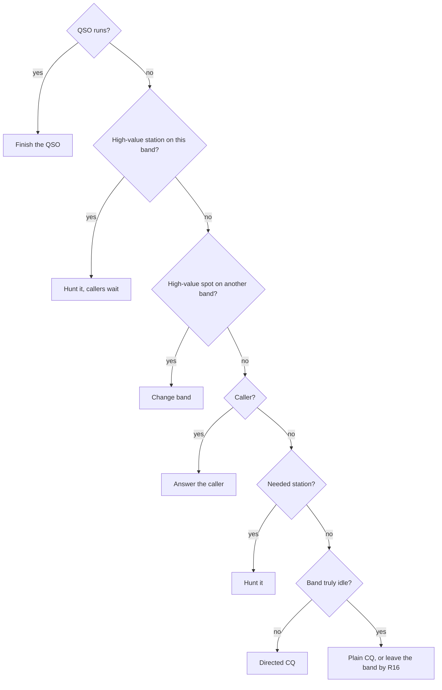

# Automatic FT8 and FT4 hunter for auto8 - Plan

## Goal Capsule

- Objective: while the operator is present, at the station or remotely, the station works needed entities and band slots in FT8 and FT4 with no clicks. Other stations see a well-behaved FT8 or FT4 station.
- Product authority: the Product Contract of this plan. Where this plan conflicts with the draft plan `docs/plans/2026-11-20-1003-feat-auto8-v1-plan.md`, this plan governs. The operator rules in `CLAUDE.md` apply, except the rule that R29 changes.
- Open blockers: three changes in other projects (Dependencies). auto8 files each one as a blocked request and writes no code there.

---

## Product Contract

### Summary

auto8 becomes a fully automatic FT8 and FT4 hunter that runs only while the operator is present. It moves across the bands in a list that the operator keeps. On each band it hunts the stations that chase-queue marks as needed, and it answers callers. If no other task exists, it calls CQ. It chooses a free TX offset and hops it from time to time.

### Problem Frame

Today the operator hunts needed entities in FT8 and FT4 by hand. The operator selects a band, watches the decodes, calls, and answers callers. Openings and rare stations go by while the operator does other work, or while the operator operates remotely from a laptop. A manual hunt also visits the bands at random. So a quiet band, such as 80 m in daytime, costs the same time as an open band.

The station has the parts that an automatic hunter needs, but nothing joins them. chase-queue knows which stations are needed. horstreporter knows which bands are active. StationA can change the band, and the antennas, tuner and PA follow the band by themselves. WSJT-X and MSHV decode and run the QSO sequence.

### Actors

- A1. Operator: enables and stops auto8, keeps the band list, and is present while auto8 transmits.
- A2. auto8: decides what the station does next and asks WSJT-X or MSHV to do it.
- A3. WSJT-X or MSHV: decodes, transmits and runs the QSO sequence. It runs on the same computer as auto8.
- A4. chase-queue (opsotter): decides which stations are needed.
- A5. StationA: carries the band commands and reports the radio and PA state.
- A6. horstreporter: reports band activity from PSK Reporter data.
- A7. logotter (opsotter): sends the presence heartbeat and takes the logged QSOs.

### Key Decisions

- **Attended operation only, also remote.** "Fully automatic" means no clicks, not no operator. Governs R2, R7. (session-settled: user-directed, chosen over unattended operation: the presence rule of `CLAUDE.md` stays, and remote-attended operation from a laptop counts as present)
- **auto8 acts on the station only through band commands.** Governs R5, R6. (session-settled: user-directed, chosen over commands for the PA and the power, and over no station commands at all: StationA moves antennas, tuner and PA band by itself, and auto8 only guards the PA state)
- **No power limit in this version.** The 20% power rule moves to a later version. Governs R6. (session-settled: user-directed, chosen over a bridge power limit with a guard, and over a guard on the drive: the operator decided that this version does not limit the power)
- **A patched WSJT-X build is the path for CQ and the TX offset.** Stock WSJT-X UDP cannot set the TX offset. It also cannot turn Enable Tx on. Governs R24, R25. (session-settled: user-directed, chosen over waiting for an upstream feature, over MSHV first, and over driving the program GUI)
- **High value means an ATNO or a first-tier expedition.** Governs R10. (session-settled: user-directed, chosen over any unworked need and over the top rows of chase-queue)
- **The operator keeps the band list, and activity selects the mode.** Governs R14, R15. (session-settled: user-directed, chosen over FT8 only and over all bands without a list)
- **Foraging selects the band, and a high-value spot interrupts it.** Governs R16, R17, R18. (session-settled: user-directed, chosen over a fixed rotation by activity and over following every spot)
- **CQ by auto8 is allowed as the last task.** Governs R22, R23. (session-settled: user-directed, chosen over no CQ and over directed CQ only)
- **Logged QSOs reach the log live from the UDP QSO packet.** Governs R12. (session-settled: user-directed, chosen over the manual ADIF import in logotter: a station that auto8 just worked must not stay needed)
- **Two old rules no longer apply.** The v1 rule D3 says that auto8 never turns Enable Tx on. The `CLAUDE.md` rule says that auto8 does not change the radio. Governs R29. (session-settled: user-approved, the operator confirmed the scope with this consequence shown)

### Requirements

**Operation and safety**

- R1. When the operator enables auto8, it hunts, answers, calls CQ and changes band with no click of the operator.
- R2. auto8 transmits only while it is enabled and the operator is present. Present means a live logotter presence heartbeat, from the station PC or from the laptop of the operator during remote operation.
- R3. The operator can stop auto8 at once. When auto8 stops, or when presence or a required input becomes stale or missing, auto8 sends HaltTx and makes no new call.
- R4. When the operator halts TX, turns Enable Tx off, or changes band or mode in WSJT-X or MSHV, auto8 disables itself.
- R5. auto8 transmits only while the live PA state shows standby, bypass or off. If the PA state changes to operate, or becomes stale or missing, auto8 halts TX at once.
- R6. auto8 acts on the station only with band and frequency commands on the StationA bus. It never commands the PA, the radio power, the antennas, the tuner or the rotators.
- R7. auto8 runs on the computer where WSJT-X or MSHV runs: the station PC, or the laptop of the operator during remote operation.
- R8. auto8 shows its state to the operator: enabled or stopped, band and mode, current task, the reason for the last stop, and reduced mode (R25).

**Finding and choosing stations**

- R9. chase-queue decides which stations are needed. auto8 sends each station that it decodes to chase-queue as a candidate source and reads the answer from the state of chase-queue.
- R10. A high-value station has a need that chase-queue marks as ATNO, or chase-queue lists it as a first-tier expedition.
- R11. auto8 answers a station that calls the operator, unless auto8 is busy with a high-value station. A caller interrupts the hunt for a station that is not high value.
- R12. auto8 takes each logged QSO from the UDP QSO packet of WSJT-X or MSHV and makes it reach the log at once. auto8 never calls a station again on a band where it just worked that station.
- R13. auto8 never stops a running QSO to start another task.

**Bands and modes**

- R14. auto8 uses only the bands in a list that the operator keeps.
- R15. On each band, auto8 selects FT8 or FT4 by the activity on the band and by where the needed stations are.
- R16. auto8 stays on a band while the band gives needed QSOs at a rate above the average of all listed bands. If the rate drops below that average, auto8 leaves the band. It also visits the other bands for short samples.
- R17. auto8 measures the activity of a band from its own decodes and from the PSK Reporter data of horstreporter. A band with low activity gets short visits. Until auto8 has enough results for R16, it selects bands by activity only.
- R18. When chase-queue shows a spot of a high-value station on another listed band, auto8 changes to that band as soon as no QSO runs.
- R19. auto8 never changes band or mode while a QSO runs.

**TX frequency**

- R20. auto8 selects its TX offset at a place where the band activity shows no station.
- R21. auto8 moves its TX offset to another free place from time to time. It does this also without a visible clash, to get past stations that it cannot hear. The number of moves per hour has an upper limit.

**CQ**

- R22. When auto8 hears no needed station and no caller on the band, it calls a directed CQ ("CQ DX"). A truly idle band has no needed station and no caller, and no listed band has a high-value spot. Only on a truly idle band does auto8 call a plain CQ.
- R23. A CQ run has an upper limit on its length.

**Programs**

- R24. CQ (R22) and the choice of the TX offset (R20, R21) use a patched WSJT-X build. Its UDP commands set the TX offset and turn Enable Tx on. auto8 describes these commands. The patched build lives in its own fork, outside this repository.
- R25. With stock WSJT-X or with MSHV, auto8 runs in reduced mode. It hunts and answers, but it calls no CQ and does not choose its TX offset.

**Behavior on the air**

- R26. auto8 calls a station only after that station sends CQ, RR73, RRR or 73. It never calls into an open QSO of that station.
- R27. auto8 never transmits on the TX offset of the station that it calls.
- R28. auto8 calls one station for a limited number of tries. Then it skips that station for a time and goes to the next task.

**Rules of this repository**

- R29. The `CLAUDE.md` rule "It does not change the radio, the PA or the antennas" changes to the rule of R6. The draft v1 plan decision D3 no longer applies to auto8 with this plan. Both changes are process or TX control changes, so they need the approval of the operator.

### Key Flows

- F1. Hunt on a band
  - **Trigger:** The operator enables auto8, and the operator is present.
  - **Actors:** A1, A2, A3, A4, A5
  - **Steps:** auto8 changes to a listed band and selects FT8 or FT4. It decodes and sends the decoded stations to chase-queue. When a needed station sends CQ or ends a QSO, auto8 calls it. WSJT-X runs the QSO, and auto8 takes the logged QSO from the UDP packet.
  - **Covered by:** R1, R9, R12, R14, R15, R26

- F2. A station calls the operator
  - **Trigger:** A decode shows a station that calls the operator.
  - **Actors:** A2, A3, A4
  - **Steps:** A hunt for a high-value station continues, and the caller waits. In every other case, auto8 answers the caller after the running QSO.
  - **Covered by:** R10, R11, R13

- F3. Leave a band
  - **Trigger:** The rate of needed QSOs on the band drops below the average. Or chase-queue shows a high-value spot on another listed band.
  - **Actors:** A2, A4, A5, A6
  - **Steps:** auto8 waits until no QSO runs. Then it changes band with a bus command. StationA moves antennas, tuner and PA band.
  - **Covered by:** R16, R17, R18, R19

- F4. Stop
  - **Trigger:** The operator stops auto8, presence lapses, an input becomes stale, the PA goes to operate, or the operator takes over in WSJT-X.
  - **Actors:** A1, A2, A3, A5, A7
  - **Steps:** auto8 sends HaltTx, makes no new call, and shows the reason.
  - **Covered by:** R3, R4, R5, R8

The diagram shows the order in which auto8 selects its next task. The requirements above carry each rule in full.

### Acceptance Examples

- AE1. **Covers R11.**
  - **Given:** auto8 hunts a needed station that is not high value.
  - **Event:** Another station calls the operator.
  - **Then:** auto8 answers the caller after the running QSO.
- AE2. **Covers R10, R11.**
  - **Given:** auto8 hunts a station that chase-queue marks as ATNO.
  - **Event:** Another station calls the operator.
  - **Then:** auto8 does not answer and continues the hunt.
- AE3. **Covers R18, R19.**
  - **Given:** A QSO runs on 20 m.
  - **Event:** chase-queue shows a first-tier expedition on 17 m.
  - **Then:** auto8 finishes the QSO. After it, auto8 changes to 17 m.
- AE4. **Covers R5.**
  - **Given:** auto8 calls a station.
  - **Event:** The PA state changes to operate.
  - **Then:** auto8 halts TX at once and shows the reason.
- AE5. **Covers R2, R3.**
  - **Given:** auto8 runs on the laptop of the operator.
  - **Event:** The bus link drops, and the presence heartbeat lapses.
  - **Then:** auto8 sends HaltTx and makes no new call.
- AE6. **Covers R4.**
  - **Given:** auto8 is enabled.
  - **Event:** The operator presses Halt Tx in WSJT-X.
  - **Then:** auto8 disables itself and does not call in the next cycle.
- AE7. **Covers R25.**
  - **Given:** auto8 runs with stock WSJT-X.
  - **Event:** The band has no needed station and no caller.
  - **Then:** auto8 calls no CQ and shows reduced mode.
- AE8. **Covers R12.**
  - **Given:** auto8 worked a station on 15 m.
  - **Event:** chase-queue still shows the station as needed on 15 m.
  - **Then:** auto8 does not call it again on 15 m.

### Success Criteria

- With auto8, the operator works new entities and band slots that a manual hunt misses.
- No station or operator on the air complains about the behavior of the station while auto8 runs it.

### Scope Boundaries

**Deferred for later**

- The 20% power limit for automatic operation.
- A CQ aimed at a region or continent.
- The use of the hardware PA arm as a second guard.
- A proof that the operator is at the radio, beyond the logotter heartbeat.

**Outside this version**

- Unattended operation.
- Any transmission with the PA in the path.
- Contests and RTTY.
- Parallel QSOs, such as the multi-answer mode of MSHV.

### Dependencies and Assumptions

- chase-queue must take auto8 as a new candidate source for FT8 and FT4 decodes. auto8 files this as a blocked request in opsotter.
- A component of opsotter must write the QSOs that auto8 takes from the UDP packet into the log database. auto8 cannot write code there. logotter use case C41 names this need.
- The patched WSJT-X build (R24) needs UDP commands for the TX offset and for Enable Tx. The fork is a separate project.
- auto8 reads band activity from the horstreporter HTTP API, because horstreporter does not publish on MQTT.
- Assumption: 60 m stays off the band list while this version has no power limit. The reason is that the radio power can exceed the German limit of 15 W EIRP on 60 m.
- Assumption: for this version, the logotter presence heartbeat counts as "operator present". This also holds for a heartbeat from the laptop.

### Outstanding Questions

**Deferred to Planning**

- Where the operator enables and stops auto8 and sees its state (R8): a page of auto8 that follows the opsotter `docs/DESIGN.md`, a view in logotter, or both.
- The default numbers for the limits in R21, R23 and R28, and the sample length in R16.
- Which UDP messages MSHV accepts, and so how much of R1 works with MSHV.
- How auto8 sends a band and mode change so that WSJT-X follows it.

### Sources

- `docs/plans/2026-11-20-1003-feat-auto8-v1-plan.md`: the draft v1 plan with decisions D1 to D6.
- StationA `docs/station-integration-model.md`: radio commands `set_band` and `set_freq`, the PA state (`operate`, `standby`, `bypass`), and the band follow of antennaselect.
- opsotter `operating/chase-queue/docs/chase-queue-mqtt-api.md`: the row fields `needs[]` with `atno`, and the `expedition` tier.
- horstreporter `docs/api.md`: `/api/dx_conditions` (`activity_level`, `activity_ratio`), `/api/hot_bands`, `/api/prop_intel/v2`.
- WSJT-X `Network/NetworkMessage.hpp` and `widgets/mainwindow.cpp`: no UDP message sets the TX offset or turns Enable Tx on.
