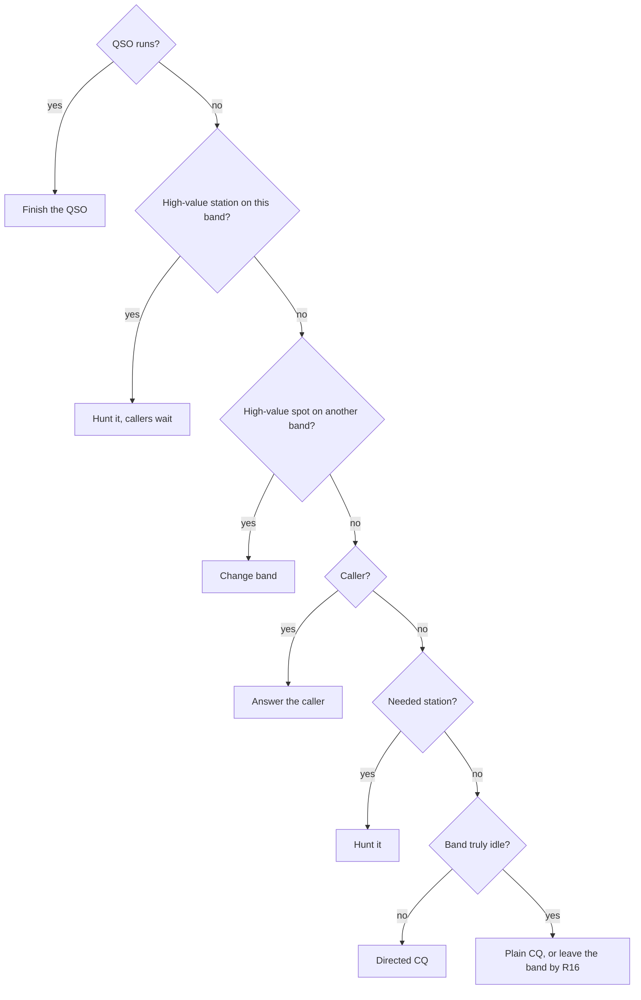
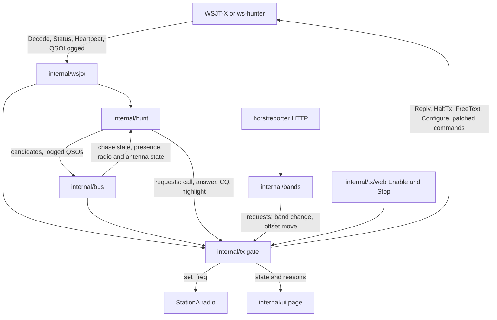
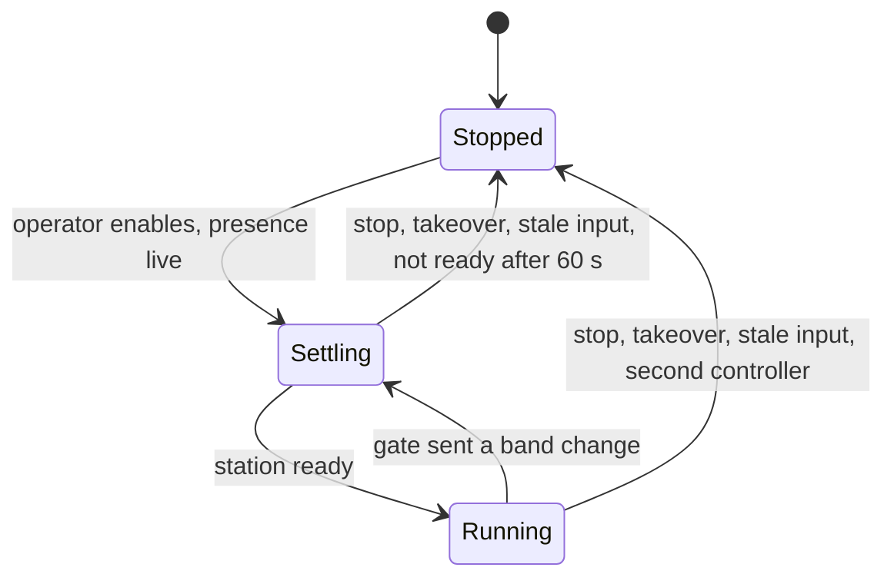
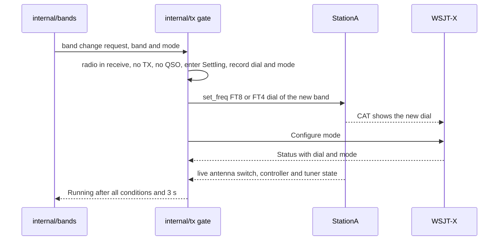

# Automatic FT8 and FT4 hunter for auto8 - Plan

## Goal Capsule

- Objective: while the operator is present, at the station or remotely, the station works needed entities and band slots in FT8 and FT4 with no clicks. Other stations see a well-behaved FT8 or FT4 station.
- Means: one auto8 process next to WSJT-X reads decodes over UDP and asks chase-queue what is needed. It sends every transmit request through one gate in `internal/tx` (KTD1, KTD2).
- Product authority: the Product Contract of this plan, then the Planning Contract. Where this plan conflicts with the draft plan `docs/plans/2026-11-20-1003-feat-auto8-v1-plan.md`, this plan governs. The operator rules in `CLAUDE.md` apply, except the rule that R29 changes.
- Execution profile: five pull requests in the order of Implementation Units. PR1 and PR3 change process files or TX control, so the operator approves them. The other pull requests merge after the required jobs pass.
- Stop conditions: stop and ask the operator in four cases. A unit needs code in another project. A unit needs a TX control path outside `internal/tx`. A test against the real WSJT-X or ws-hunter shows a protocol fact that contradicts a KTD. A unit needs a secret, a host address or a callsign in the repository.
- Open blockers: three changes in other projects (Risks and Dependencies). auto8 runs in a reduced form until they land.

Product Contract preservation: changed during planning on 2026-11-21 by decisions of the operator. R5 is removed. R4, R7, R12 and R25 no longer name MSHV. R30, R31 and R32 are new. AE4 is removed. Outstanding questions are resolved in KTD5, KTD12, KTD15 and R25.

---

## Product Contract

### Summary

auto8 becomes a fully automatic FT8 and FT4 hunter that runs only while the operator is present. It moves across the bands in a list that the operator keeps. On each band it hunts the stations that chase-queue marks as needed, and it answers callers. If no other task exists, it calls CQ. It chooses a free TX offset and hops it from time to time.

### Problem Frame

Today the operator hunts needed entities in FT8 and FT4 by hand. The operator selects a band, watches the decodes, calls, and answers callers. Openings and rare stations go by while the operator does other work, or while the operator operates remotely from a laptop. A manual hunt also visits the bands at random. So a quiet band, such as 80 m in daytime, costs the same time as an open band.

The station has the parts that an automatic hunter needs, but nothing joins them. chase-queue knows which stations are needed. horstreporter knows which bands are active. StationA can change the band, and the antennas, tuner and PA follow the band by themselves. WSJT-X decodes and runs the QSO sequence.

### Actors

- A1. Operator: enables and stops auto8, keeps the band list, keeps the PA out of the path, and is present while auto8 transmits.
- A2. auto8: decides what the station does next and asks WSJT-X to do it.
- A3. WSJT-X: decodes, transmits and runs the QSO sequence. It runs on the same computer as auto8.
- A4. chase-queue (opsotter): decides which stations are needed.
- A5. StationA: carries the band commands and reports the radio and antenna state.
- A6. horstreporter: reports band activity from PSK Reporter data.
- A7. logotter (opsotter): sends the presence heartbeat and takes the logged QSOs.

### Key Decisions

- **Attended operation only, also remote.** "Fully automatic" means no clicks, not no operator. Governs R2, R7. (session-settled: user-directed, chosen over unattended operation: the presence rule of `CLAUDE.md` stays, and remote-attended operation from a laptop counts as present)
- **auto8 acts on the station only through band commands.** Governs R6. (session-settled: user-directed, chosen over commands for the PA and the power, and over no station commands at all: StationA moves antennas, tuner and PA band by itself)
- **No PA guard in this version.** auto8 neither commands nor reads the PA. Governs R6. (session-settled: user-directed, chosen over a guard on PA standby or a proven off: the operator dropped the PA requirement R5)
- **No power limit in this version.** The 20% power rule moves to a later version. Governs R6. (session-settled: user-directed, chosen over a bridge power limit with a guard, and over a guard on the drive: the operator decided that this version does not limit the power)
- **A patched WSJT-X build is the path for CQ and the TX offset.** Stock WSJT-X UDP cannot set the TX offset. It also cannot turn Enable Tx on without a Reply. Governs R24, R25. (session-settled: user-directed, chosen over waiting for an upstream feature, over MSHV first, and over driving the program GUI)
- **MSHV is not in this version.** MSHV ignores the TX offset and reports it as 0, so auto8 cannot keep R27 with it. Governs R7, R25. (session-settled: user-directed, chosen over hunting with a fixed offset, and over highlights only)
- **High value means an ATNO or a first-tier expedition.** Governs R10. (session-settled: user-directed, chosen over any unworked need and over the top rows of chase-queue)
- **The operator keeps the band list, and activity selects the mode.** Governs R14, R15. (session-settled: user-directed, chosen over FT8 only and over all bands without a list)
- **Foraging selects the band, and a high-value spot interrupts it.** Governs R16, R17, R18. (session-settled: user-directed, chosen over a fixed rotation by activity and over following every spot)
- **CQ by auto8 is allowed as the last task.** Governs R22, R23. (session-settled: user-directed, chosen over no CQ and over directed CQ only)
- **Logged QSOs reach the log live from the UDP QSO packet.** Governs R12. (session-settled: user-directed, chosen over the manual ADIF import in logotter: a station that auto8 just worked must not stay needed)
- **Every stop latches.** Governs R30. (session-settled: user-directed, chosen over a resume after short gaps, and over a resume as soon as the reason clears)
- **Fox/Hound gets a highlight and an alert only.** Governs R31. (session-settled: user-directed, chosen over a hunt in Hound mode that the operator sets, and over ignoring Fox/Hound)
- **A readiness wait follows each band change.** Nothing in StationA stops barefoot TX into a switching antenna relay. Governs R32. (session-settled: user-approved, the operator confirmed the planning summary with this wait shown)
- **Two old rules no longer apply.** The v1 rule D3 says that auto8 never turns Enable Tx on. The `CLAUDE.md` rule says that auto8 does not change the radio. Governs R29. (session-settled: user-approved, the operator confirmed the scope with this consequence shown)

### Requirements

**Operation and safety**

- R1. When the operator enables auto8, it hunts, answers, calls CQ and changes band with no click of the operator.
- R2. auto8 transmits only while it is enabled and the operator is present. Present means a live logotter presence heartbeat, from the station PC or from the laptop of the operator during remote operation.
- R3. The operator can stop auto8 at once. When auto8 stops, or when presence or a required input becomes stale or missing, auto8 sends HaltTx and makes no new call.
- R4. When the operator halts TX, turns Enable Tx off, or changes band or mode in WSJT-X, auto8 disables itself.
- R6. auto8 acts on the station only with band and frequency commands on the StationA bus. It never commands the PA, the radio power, the antennas, the tuner or the rotators.
- R7. auto8 runs on the computer where WSJT-X runs: the station PC, or the laptop of the operator during remote operation.
- R8. auto8 shows its state to the operator: enabled or stopped, band and mode, current task, the reason for the last stop, and reduced mode (R25).
- R30. Every stop latches. After a stop, auto8 calls again only after the operator enables it again.
- R32. After a band change, auto8 transmits only after the station reports that the antenna switch settled, the antenna controller stopped, and the tuner finished.

**Finding and choosing stations**

- R9. chase-queue decides which stations are needed. auto8 sends each station that it decodes to chase-queue as a candidate source and reads the answer from the state of chase-queue.
- R10. A high-value station has a need that chase-queue marks as ATNO, or chase-queue lists it as a first-tier expedition.
- R11. auto8 answers a station that calls the operator, unless auto8 is busy with a high-value station. A caller interrupts the hunt for a station that is not high value.
- R12. auto8 takes each logged QSO from the UDP QSO packet of WSJT-X and makes it reach the log at once. auto8 never calls a station again on a band where it just worked that station.
- R13. auto8 never stops a running QSO to start another task.
- R31. auto8 does not follow a spot on a Fox/Hound dial frequency and does not call while WSJT-X is in a special operating mode. It highlights such a station and shows the spot to the operator.

**Bands and modes**

- R14. auto8 uses only the bands in a list that the operator keeps.
- R15. On each band, auto8 selects FT8 or FT4 by the activity on the band and by where the needed stations are.
- R16. auto8 stays on a band while the band gives needed QSOs at a rate above the average of all listed bands. If the rate drops below that average, auto8 leaves the band. It also visits the other bands for short samples.
- R17. auto8 measures the activity of a band from its own decodes and from the PSK Reporter data of horstreporter. A band with low activity gets short visits. Until auto8 has enough results for R16, it selects bands by activity only.
- R18. When chase-queue shows a spot of a high-value station on another listed band, auto8 changes to that band as soon as no QSO runs.
- R19. auto8 never changes band or mode while a QSO runs.

**TX frequency**

- R20. auto8 selects its TX offset at a place where the band activity shows no station.
- R21. auto8 moves its TX offset to another free place from time to time. It does this also without a visible clash, to get past stations that it cannot hear. The number of moves per hour has an upper limit.

**CQ**

- R22. When auto8 hears no needed station and no caller on the band, it calls a directed CQ ("CQ DX"). A truly idle band has no needed station and no caller, and no listed band has a high-value spot. Only on a truly idle band does auto8 call a plain CQ.
- R23. A CQ run has an upper limit on its length.

**Programs**

- R24. CQ (R22) and the choice of the TX offset (R20, R21) use a patched WSJT-X build. Its UDP commands set the TX offset and turn Enable Tx on. auto8 describes these commands. The patched build lives in its own fork, outside this repository.
- R25. With stock WSJT-X, auto8 runs in reduced mode. It hunts and answers, but it calls no CQ and does not choose its TX offset.

**Behavior on the air**

- R26. auto8 calls a station only after that station sends CQ, RR73, RRR or 73. It never calls into an open QSO of that station.
- R27. auto8 never transmits on the TX offset of the station that it calls.
- R28. auto8 calls one station for a limited number of tries. Then it skips that station for a time and goes to the next task.

**Rules of this repository**

- R29. The `CLAUDE.md` rule "It does not change the radio, the PA or the antennas" changes to the rule of R6. The draft v1 plan decision D3 no longer applies to auto8 with this plan. Both changes are process or TX control changes, so they need the approval of the operator.

### Key Flows

- F1. Hunt on a band
  - **Trigger:** The operator enables auto8, and the operator is present.
  - **Actors:** A1, A2, A3, A4, A5
  - **Steps:** auto8 changes to a listed band and selects FT8 or FT4. It decodes and sends the decoded stations to chase-queue. When a needed station sends CQ or ends a QSO, auto8 calls it. WSJT-X runs the QSO, and auto8 takes the logged QSO from the UDP packet.
  - **Covered by:** R1, R9, R12, R14, R15, R26

- F2. A station calls the operator
  - **Trigger:** A decode shows a station that calls the operator.
  - **Actors:** A2, A3, A4
  - **Steps:** A hunt for a high-value station continues, and the caller waits. In every other case, auto8 answers the caller after the running QSO.
  - **Covered by:** R10, R11, R13

- F3. Leave a band
  - **Trigger:** The rate of needed QSOs on the band drops below the average. Or chase-queue shows a high-value spot on another listed band.
  - **Actors:** A2, A4, A5, A6
  - **Steps:** auto8 waits until no QSO runs. Then it changes band with a bus command. StationA moves antennas, tuner and PA band, and auto8 waits for the station to settle.
  - **Covered by:** R16, R17, R18, R19, R32

- F4. Stop
  - **Trigger:** The operator stops auto8, presence lapses, an input becomes stale, or the operator takes over in WSJT-X.
  - **Actors:** A1, A2, A3, A7
  - **Steps:** auto8 sends HaltTx, makes no new call, and shows the reason. It stays stopped until the operator enables it again.
  - **Covered by:** R3, R4, R8, R30

The diagram shows the order in which auto8 selects its next task. The requirements above carry each rule in full.



### Acceptance Examples

- AE1. **Covers R11.**
  - **Given:** auto8 hunts a needed station that is not high value.
  - **Event:** Another station calls the operator.
  - **Then:** auto8 answers the caller after the running QSO.
- AE2. **Covers R10, R11.**
  - **Given:** auto8 hunts a station that chase-queue marks as ATNO.
  - **Event:** Another station calls the operator.
  - **Then:** auto8 does not answer and continues the hunt.
- AE3. **Covers R18, R19.**
  - **Given:** A QSO runs on 20 m.
  - **Event:** chase-queue shows a first-tier expedition on 17 m.
  - **Then:** auto8 finishes the QSO. After it, auto8 changes to 17 m.
- AE5. **Covers R2, R3, R30.**
  - **Given:** auto8 runs on the laptop of the operator.
  - **Event:** The bus link drops, and the presence heartbeat lapses. Later both come back.
  - **Then:** auto8 sends HaltTx, makes no new call, and stays stopped until the operator enables it again.
- AE6. **Covers R4.**
  - **Given:** auto8 is enabled.
  - **Event:** The operator presses Halt Tx in WSJT-X.
  - **Then:** auto8 disables itself and does not call in the next cycle.
- AE7. **Covers R25.**
  - **Given:** auto8 runs with stock WSJT-X.
  - **Event:** The band has no needed station and no caller.
  - **Then:** auto8 calls no CQ and shows reduced mode.
- AE8. **Covers R12.**
  - **Given:** auto8 worked a station on 15 m.
  - **Event:** chase-queue still shows the station as needed on 15 m.
  - **Then:** auto8 does not call it again on 15 m.
- AE9. **Covers R32.**
  - **Given:** auto8 changed from 20 m to 17 m.
  - **Event:** The antenna switch has not settled yet.
  - **Then:** auto8 does not transmit until the switch settled, the antenna controller stopped and the tuner finished.
- AE10. **Covers R31.**
  - **Given:** chase-queue shows a first-tier expedition on 14090 kHz, a Fox/Hound dial.
  - **Event:** auto8 sees the spot.
  - **Then:** auto8 does not change band. It highlights the station and shows the spot.

### Success Criteria

- With auto8, the operator works new entities and band slots that a manual hunt misses.
- No station or operator on the air complains about the behavior of the station while auto8 runs it.

### Scope Boundaries

**Deferred for later**

- The 20% power limit for automatic operation.
- A guard on the PA state.
- MSHV support.
- A hunt in Fox/Hound mode.
- A CQ aimed at a region or continent.
- A proof that the operator is at the radio, beyond the logotter heartbeat.

**Outside this version**

- Unattended operation.
- Contests and RTTY.
- Parallel QSOs, such as the multi-answer mode of MSHV.

**Considered and not built**

- A chase-queue `skip` after a give-up. A skip also hides the station in the logotter view of the operator until 00:00 UTC. auto8 keeps its own skip list (KTD16). A wish of the operator for a shared skip changes this call.
- A per-mode activity split in horstreporter. auto8 measures FT8 against FT4 from its own decodes (KTD12). Poor mode choices in practice change this call.

### Sources

- `docs/plans/2026-11-20-1003-feat-auto8-v1-plan.md`: the draft v1 plan with decisions D1 to D6.
- StationA `docs/station-integration-model.md` and `flexbridge/internal/bridge/bridge.go`: radio commands `set_band` and `set_freq`, the radio state, and the band follow of antennaselect.
- opsotter `operating/chase-queue/docs/chase-queue-mqtt-api.md` and `internal/bus/bus.go`: the row fields `needs[]` with `atno`, and the `expedition` tier.
- horstreporter `docs/api.md`: `/api/dx_conditions` (`activity_level`, `activity_ratio`) and `/api/hot_bands`.
- WSJT-X `Network/NetworkMessage.hpp`, `widgets/mainwindow.cpp` and `models/FrequencyList.cpp`: the UDP messages, the Reply and Enable Tx behavior, and the default dial frequencies.
- ws-hunter (`github.com/TheBengineer/ws-hunter`, branch `hunter`): the message types 24 to 28.

---

## Planning Contract

### Key Technical Decisions

- KTD1. **One process, small packages, one direction of imports.** `cmd/auto8` starts one process with these packages:
  1. `internal/wsjtx`: receives and decodes WSJT-X datagrams.
  2. `internal/bus`: MQTT subscriptions and publishes.
  3. `internal/hunt`: needs, task choice and the local lists.
  4. `internal/bands`: foraging, mode choice and offset choice.
  5. `internal/ui`: the read-only state page.
  6. `internal/tx`: TX control, with its senders under `internal/tx/send`.

  `internal/tx` imports only the types of `wsjtx`, `bus` and `config`. `hunt`, `bands` and `ui` import only the request and state types of `tx`. The gate state has one owner goroutine fed by channels. One process is chosen over a separate TX guard process, which needs extra IPC and a second presence receiver. Small packages are chosen over one flat package, which puts all code under operator review.
- KTD2. **One gate in `internal/tx` decides and sends.** The other packages hand typed requests to the gate: call, answer, give-up, CQ, offset move, band change and highlight. The gate decides each request and records the reason for each refusal. It owns these rules:
  1. The arm state (R30), presence (KTD7), input ages (KTD8), the readiness wait (KTD10) and the record of own commands (KTD9).
  2. The QSO view (KTD11) and the refusal of calls while Special Op Mode is not 0 (R31).
  3. Request timing: each call or answer request carries the time of its source decode. The gate refuses a request older than one period. It also refuses a request that arrives later than 2 s after the slot start. The reason is "too late for this slot".
  4. Hard limits as constants: ceilings for the CQ run and the offset moves per hour, and a floor for the offset distance of R27 (KTD15).
  5. All senders: Reply, HaltTx, FreeText, Configure, HighlightCallsign, the ws-hunter commands, and `set_freq` on the bus.

  Only `cmd/auto8` builds the UDP send handle and the raw bus publish handle for `radio/cmd`, and it passes them only to the gate. `internal/bus` exports only typed publish methods for the auto8 slot topics, and no general topic publish. A test in `internal/tx` reads the import graph. If a package outside `internal/tx` imports `internal/tx/send`, the test fails. If a package outside `internal/tx`, `internal/bus` and `cmd/auto8` imports paho, the test also fails. Governs R2, R3, R4, R13, R19, R27, R30, R31, R32.
- KTD3. **Patched build: the ws-hunter message types.** auto8 uses the ws-hunter types 24 (SetTxDF), 25 (SetHoldTxFreq), 26 (SetTxEnabled), 27 (SpectrumSummary) and 28 (ClearDX) as its contract. It detects the build from the Heartbeat revision suffix `-hunter`. Without that suffix, auto8 runs in reduced mode, and the gate refuses CQ and offset requests. ws-hunter is a GPL-3 fork of WSJT-X Improved, and auto8 only talks to it over UDP, so auto8 copies no GPL code. Governs R24, R25. (session-settled: user-directed, chosen over a wait for an upstream feature, over MSHV first, and over driving the GUI. The operator chose a patched build, and ws-hunter contains the needed commands)
- KTD4. **Own UDP codec, fixed peer.** auto8 carries its own codec for the WSJT-X protocol, schema 3, with the ws-hunter types. The receive side lives in `internal/wsjtx`, and the command encoders live in `internal/tx/send`. The library `k0swe/wsjtx-go` reads into a fixed 1024-byte buffer, keeps one peer address, and has no hook for extra types. The codec is chosen over a fork of that library, because auto8 must then maintain the fork. The socket binds to `127.0.0.1` and accepts only the configured WSJT-X Id. The peer address is fixed at the first Heartbeat. A later change of the source address counts as a stale WSJT-X input (KTD8). auto8 learns a new address only while it is stopped. Governs R7.
- KTD5. **Operator surface: a guarded local page plus a bus slot.** The Enable and Stop handlers live in `internal/tx/web`, and `internal/ui` renders the state around them. These rules guard the handlers:
  1. Only POST changes state. Each POST must carry the configured loopback Host and port.
  2. Each POST must carry `Sec-Fetch-Site: same-origin` or an Origin equal to that address, and a form token that the process creates at start.
  3. All page text is HTML-escaped, and the page sends a Content-Security-Policy that blocks inline and outside scripts. Spot comments are free text from the internet.

  auto8 publishes a retained state on its own host slot `<site>/hf/auto8/<host>/state` and accepts only the action `stop` on `<site>/hf/auto8/cmd`. It drops retained commands and logs other actions as refused. The page is chosen over Enable on the bus, because then any account with write access can arm auto8. A view in logotter is work in another project, and a terminal interface does not serve a remote laptop well. Governs R3, R8.
- KTD6. **MQTT and configuration follow opsotter.** auto8 uses `paho.mqtt.golang` v1.5.1 and `BurntSushi/toml` v1.6.0. It vendors the StationA packages `shared/mqtt`, `shared/schema` and `shared/logging` into `third_party/stationa-shared/`, because codeberg is not reachable. These configuration rules apply:
  1. The password comes only from `AUTO8_MQTT_PASSWORD`, and a password in the file is refused.
  2. The broker URL must use `ssl://`, unless its host is a loopback or private address, such as a VPN address.
  3. The band list refuses 60 m while no power limit exists, and refuses FT4 on 160 m.
  4. Each limit of KTD15 has a minimum and a maximum, and a value outside them is refused. For the CQ run, the offset moves and the offset distance, the bounds are the hard-limit constants of the gate. So the two cannot drift apart.

  Governs R14.
- KTD7. **Presence from listed hosts.** auto8 counts `present:true` only from the hosts in a configured list. By default, the list holds only the host name of auto8 itself. A host counts for 90 s after its last message, by the receive time of auto8, and auto8 ignores retained deliveries. The list is chosen over "any host", because during remote operation the station PC logotter keeps sending presence after the operator leaves the laptop. The page shows which host gives presence. Governs R2.
- KTD8. **Input ages decide stop or reduce.** These inputs stop auto8 (R30): a stale presence (90 s), a stale WSJT-X heartbeat (30 s) and a stale radio state (15 s). A lost bus link, a StationA source with status `offline`, and a WSJT-X restart or change of revision also stop auto8. A stale chase-queue state (75 s) pauses hunting, and auto8 still answers callers. A failed horstreporter request reduces the activity data to the own decodes. Governs R3, R17.
- KTD9. **auto8 records its own commands.** The gate keeps a short record of each dial, mode, Enable Tx and TX offset that auto8 commanded. Each entry has a time window. A change in WSJT-X Status outside that record counts as a takeover by the operator (R4). So does a change of the DX call that auto8 did not cause. The Tx watchdog is not a takeover. The operator must turn off the WSJT-X option "Call 1st", so WSJT-X never answers a caller by itself. auto8 answers callers only through its own answer request (R11). The gate reads an automatic Enable Tx off after 73 from the Tx message field of Status, so it is not a takeover either. Governs R4.
- KTD10. **Readiness wait after a band change.** After a band change, the gate refuses TX until all of these hold:
  1. The radio `tx` is `rx`, the band matches, and `tuning` is false.
  2. The antenna switch reports `settled`, with `selected` equal to the antennaselect target.
  3. The antenna controller reports `moving` false, and the tuner reports `settling` false.
  4. 3 s passed after the band edge.

  The antenna switch and the tuner publish only on change, so a band change that does not move them brings no new message. The gate therefore keeps the latest state of each source that arrived live over the current bus connection. A retained replay at subscribe does not count. The gate requires a message after the band change only from a source that the change must move. The antenna switch is such a source while the antennaselect target differs from `selected`. The antenna controller is such a source while its port is selected. The antenna controller polls every 2 s. A tuner that is offline or reports no tune cycle does not block. Each source that blocks must report status `online`. After 60 s without readiness, auto8 stops with the reason "station not ready". Governs R32.
- KTD11. **The gate owns the QSO view.** A QSO starts at the first decode from the DX call that carries the call of the operator. It ends at QSOLogged, at the sent RR73 or 73 plus two periods, or after four periods with no reply. The gate builds this view only from WSJT-X data: Status, decodes with the operator call, and QSOLogged. `internal/hunt` keeps no copy. It reads the QSO view from the state type that the gate exposes. The operator must turn on the WSJT-X option "Auto Seq", so WSJT-X runs the QSO sequence, and turn off "Prompt me to log QSO". When QSOLogged does not come after an RR73, auto8 shows "automatic log off". Governs R13, R19.
- KTD12. **Band and mode change as one gate request.** `internal/bands` sends one request with band and mode. Under its own lock, the gate does these steps:
  1. It makes sure that the radio is in receive and no QSO runs. If Enable Tx is on, it sends HaltTx with `auto_only` true and records it (KTD9). Then it waits for a Status with Enable Tx false and Transmitting false. WSJT-X keeps Enable Tx on across a CAT dial change, so without this step it can transmit on the new band in the next slot.
  2. It enters Settling and records the expected dial and mode (KTD9).
  3. It sends `set_freq` with the WSJT-X default FT8 or FT4 dial of the band, and then Configure with the mode.

  The gate sends `set_freq` first, so the dial is already in the frequency table of the mode. Then Configure does not move the rig by CAT. It never sends `set_band`, because `set_band` restores the band stack. A mode change on the same band also gets a record, because Configure can move the dial. The gate drops every decode from before the change. FT8 against FT4 comes from the own decode counts of each band visit, because horstreporter does not split its numbers by mode. Governs R15, R19.
- KTD13. **Foraging.** Each band keeps a rate of needed QSOs per hour as a moving average. A cold band starts with a rate from horstreporter `activity_ratio` and the own decode count. auto8 stays at least 2 minutes on a band and samples another band every 20 minutes. Two minutes are 8 FT8 periods or 16 FT4 periods. A high-value spot causes one jump. If auto8 does not decode that station within 2 minutes, it marks the spot "not heard here" for 30 minutes. auto8 never follows a spot on a Fox/Hound dial. The operator keeps the Fox/Hound dials as a list in the configuration file, because WSJT-X has no such table. A decode in the Fox compound form, `RR73;` with a second call, also marks the station "highlight only" for the visit, on any dial. Governs R16, R17, R18, R31.
- KTD14. **Offset guard and reduced mode.** At Enable with the full build, the gate sends SetHoldTxFreq true. With stock WSJT-X, the operator must turn on "Hold Tx Freq" and "Double-click on call sets Tx enable". In both modes, the gate compares the current TX offset with the offset of the target. If the distance is below the offset distance of KTD15, the gate refuses the call or answer request. The gate also compares the TX offset of the first Status after each Reply with the offset of the called station. If they lie within that distance, the gate sends HaltTx at once and stops with the reason "Hold Tx Freq off". If Enable Tx stays off after a Reply, auto8 stops with the reason "automatic Tx enable off". Governs R25, R27.
- KTD15. **Default limits with ranges.** These defaults live in the configuration file, and each has a range (KTD6):
  1. Tries per station: 4, which is about 1 minute in FT8. A high-value station gets 12, about 3 minutes (R28). When the count reaches the limit, `internal/hunt` sends a give-up request. If no new Reply follows in the same period, the gate sends HaltTx with `auto_only` true.
  2. Skip after a give-up: 10 minutes, kept in auto8 only (KTD16).
  3. CQ run: at most 10 periods without an answer, then four periods of listening (R23).
  4. Offset moves: at most 6 per hour, only between tasks, at least 50 Hz from the called station (R21, R27).
  5. Spot memory: "not heard here" for 30 minutes (KTD13).

  The gate holds hard ceilings for the CQ run and the offset moves, and a hard floor for the offset distance. Counted tries are chosen over a fixed time per station, which wastes time on a short FT4 slot. They are also chosen over the WSJT-X Tx watchdog alone, which ends a call far too late.
- KTD16. **Local skip and worked lists.** auto8 keeps a skip list and a worked list in a file in the user state directory, outside the repository. The worked list holds call, band, mode and UTC date for 30 days, so R12 holds after a restart and before the log intake exists. If the file cannot be read, auto8 refuses to enable and shows the reason. auto8 never sends `skip` to chase-queue. Governs R12, R28.
- KTD17. **Candidates and logged QSOs on the own slot.** auto8 publishes each decoded station on `<site>/hf/auto8/candidates`, retained. Each entry has call, band, mode FT8 or FT4, and the type of the last message. It publishes each logged QSO on `<site>/hf/auto8/qso`, not retained. chase-queue and logotter need changes to read them (Risks and Dependencies). Until chase-queue reads the candidates, auto8 hunts only stations that chase-queue already lists from cluster spots and that auto8 decodes. Governs R9, R12.
- KTD18. **One controller at all times.** auto8 publishes its host, its enabled state and a payload `ts` on its host slot `<site>/hf/auto8/<host>/state`. Its LWT goes to `<site>/hf/auto8/<host>/status`. It republishes the state every 30 s while enabled. The gate watches `<site>/hf/auto8/+/state` and `+/status` all the time and ignores its own host. Another host can report enabled, with status `online` and a `ts` within 90 s. Then both stop and latch with the reason "second controller" and the other host name. Governs R2, R6.
- KTD19. **CQ text.** With ws-hunter, a directed CQ goes out as FreeText `CQ DX <call> <grid>` followed by SetTxEnabled. A plain CQ uses ClearDX followed by SetTxEnabled. The end of a CQ run sends HaltTx with `auto_only` true. Governs R22, R23.
- KTD20. **Stops are hard and confirmed.** These stops send HaltTx with `auto_only` false, so the transmission ends at once: an operator stop, a stale input, a takeover, "station not ready" and a second controller. After a stop, the gate waits one period for a Status with Transmitting false and Enable Tx false. Without that Status, it sends HaltTx again, and the page shows "WSJT-X did not stop". auto8 starts in Stopped and sends nothing to WSJT-X until the operator enables it. On SIGINT, SIGTERM and a clean exit, `cmd/auto8` sends HaltTx through the gate before it exits. Governs R3, R30.
- KTD21. **No real station data in the repository.** Test datagrams come from an encoder with invented values. No captured datagram is committed. A test rejects any call in test data or in `config.example.toml` that is not in a list of invented calls. `.gitignore` covers capture and state files. Logs never print the broker URL with its user, or the configuration struct.

### High-Level Technical Design

The diagram shows the components and the direction of each message. Every arrow to WSJT-X and to StationA starts at the gate.



The state diagram shows the arm state that the gate owns. Every stop goes to Stopped, and only the operator leaves it (R30).



The sequence shows one band change (KTD12, KTD10).



### Output Structure

```text
cmd/auto8/main.go
config.example.toml
internal/bands/
internal/bus/
internal/config/
internal/hunt/
internal/tx/
internal/tx/send/
internal/tx/web/
internal/ui/
internal/wsjtx/
test/integration/
test/integration/peers/
third_party/stationa-shared/
```

### Assumptions

- The operator keeps the PA out of the path during automatic operation, because auto8 does not read the PA.
- The logotter presence heartbeat counts as "operator present". The operator lists the hosts that count (KTD7).
- The operator installs ws-hunter for full operation and sets the WSJT-X options that KTD9, KTD11 and KTD14 name.
- The operator keeps the WSJT-X Tx watchdog on and short, for example 2 to 3 minutes. The page lists this item with the other needed WSJT-X options.
- 60 m stays off the band list while this version has no power limit. The radio power can exceed the German limit of 15 W EIRP on 60 m.

### Risks and Dependencies

- chase-queue must read the auto8 candidates (KTD17). It reads one finder slot today and ranks every candidate as SSB. auto8 files a `blocked` issue for opsotter and runs with cluster spots only until the change lands.
- A component of opsotter must write the QSOs from `<site>/hf/auto8/qso` into the log database. logotter use case C41 names this need. auto8 files a `blocked` issue. KTD16 keeps R12 true in the meantime.
- auto8 needs its own broker account in StationA. It must read presence, chase state, radio and antenna states, and write `radio/cmd`, `chase/cmd` and its own slot. The same `blocked` issue asks for three write limits. Only logotter can write `logotter/presence`, and only chase-queue can write `chase/state`. Only the auto8 account can write `<site>/hf/auto8/#`. A later log intake trusts the QSO topic, so a foreign writer there puts QSOs into the log database. Today the shared `hf` account can write every topic. Until the own account exists, auto8 can run with the `hf` account. The operator decided this on 2026-11-21. With neither account, auto8 cannot change band.
- A hard crash of auto8 leaves WSJT-X with Enable Tx on. Then only the WSJT-X Tx watchdog ends the transmission (Assumptions).
- ws-hunter is young and has one maintainer, and it follows WSJT-X Improved, not upstream WSJT-X. When ws-hunter is missing, auto8 falls back to reduced mode (KTD3).
- WSJT-X controls the radio by CAT, and auto8 sends `set_freq` on the bus. Both act on the same slice. KTD12 sends band commands only while the radio is in receive.
- The ruleset requires the CI job `integration`, which does not exist. No pull request can merge until U4 lands. The requirements-workflow plan (`docs/plans/2026-11-20-1039-feat-requirements-workflow-plan.md`, R15) describes the same job. If that plan lands it first, U4 only adds the hunter peers and tests.

### System-Wide Impact

- StationA: auto8 becomes a second sender of `radio/cmd` next to logotter. antennaselect, the tuner and the PA follow the band as today.
- chase-queue: a new candidate source, after the blocked change.
- logotter: the operator sees band changes of auto8 in its radio view. A future intake reads `<site>/hf/auto8/qso`.
- Browser of the operator: the local page is a new surface that can arm a transmitter (KTD5).
- Repository rules: `CLAUDE.md` changes for R29.

---

## Implementation Units

| U-ID | Title | Files touched | Depends on |
|---|---|---|---|
| U11 | Change the radio rule in `CLAUDE.md` | `CLAUDE.md` | none |
| U4 | Integration test setup, peers and CI job | `.github/workflows/ci.yml`, `test/integration/` | none |
| U1 | Module, vendored packages and configuration | `go.mod`, `third_party/stationa-shared/`, `internal/config/` | U4 |
| U2 | WSJT-X receive and decode | `internal/wsjtx/` | U1 |
| U3 | Bus client | `internal/bus/` | U1 |
| U5 | Gate core: arm, inputs, stops and senders | `internal/tx/`, `internal/tx/send/`, `internal/tx/web/` | U2, U3, U11 |
| U12 | Gate rules: QSO view, takeover, band change, readiness | `internal/tx/` | U5 |
| U6 | Needs and local lists | `internal/hunt/` | U2, U3 |
| U7 | Task choice and etiquette | `internal/hunt/` | U5, U6 |
| U10 | Operator page and process wiring | `internal/ui/`, `cmd/auto8/` | U5, U6, U7, U12 |
| U8 | Band foraging | `internal/bands/` | U10, U12 |
| U9 | TX offset and CQ | `internal/bands/`, `internal/hunt/` | U8 |

### PR1: Repository rules and the integration job

Waits on: none.

### U11. Change the radio rule in `CLAUDE.md`

- **Goal:** Replace the radio rule of `CLAUDE.md` with the rule of R6.
- **Requirements:** R29, R6.
- **Dependencies:** none.
- **Files:** `CLAUDE.md`.
- **Approach:** Change only the sentence about the radio, the PA and the antennas. Keep every other rule. Write the text with the simple-english skill.
- **Execution note:** This is a process file. The operator approves it.
- **Test expectation:** none, the change is text. The writing job lints it.
- **Verification:** The writing job passes, and the operator approved the pull request.

### U4. Integration test setup, peers and CI job

- **Goal:** Add the required CI job `integration` and every test peer that later units need, so later pull requests do not touch owned paths.
- **Requirements:** supports all requirements by test, and it is the job that the ruleset requires.
- **Dependencies:** none.
- **Files:** `.github/workflows/ci.yml`, `test/integration/mosquitto.conf`, `test/integration/harness_test.go`, `test/integration/peers/wsjtx.go`, `test/integration/peers/chasequeue.go`, `test/integration/peers/station.go`, `test/integration/peers/presence.go`, `test/integration/peers/horstreporter.go`, `test/integration/peers/peers_test.go`.
- **Approach:**
  1. Add a job `integration`. After the repository step, a `docker run` step starts Mosquitto with the test configuration `test/integration/mosquitto.conf` (`listener 1883`, `allow_anonymous true`). A plain service container cannot mount that file, and Mosquitto 2 without it accepts only local connections. The job waits until the port answers, then runs the Go tests under `test/integration` with a build tag.
  2. Add a fake WSJT-X peer. It sends scripted Heartbeat with a stock or `-hunter` revision, Status with Special Op Mode, Tx DF and Enable Tx, Decode and QSOLogged. It records every inbound command, also the types 24 to 28. It carries its own small encoder on purpose, so a codec error cannot hide in both sides.
  3. Add fake chase-queue and StationA peers. They publish retained or live state for radio (`tx`, `tuning`, band) and antenna switch (`settled`, `selected`). They also publish the antenna controller (`moving`), the tuner (`settling`) and the antennaselect target, and they record commands. Each source can publish on change only or with a heartbeat.
  4. Add a presence peer that sends live or retained messages and can stop. Add a horstreporter HTTP fake that can fail on request, and a way to cut the broker link.
  5. Start with one smoke test that builds `cmd/auto8` and proves that the test setup runs.
- **Execution note:** These are process files. The operator approves them. Test data uses invented callsigns only (KTD21).
- **Patterns to follow:** `internal/flow/fake_test.go` (fake server, fixed clock, recorded writes).
- **Test scenarios:**
  - The smoke test starts the broker, the peers and `cmd/auto8`, and ends with no error.
  - The fake WSJT-X peer records a HaltTx and a SetTxDF that a test sends to it.
  - The StationA peer publishes `settled` false and then true, and a subscriber sees both.
  - If the test asks it to fail, the horstreporter fake answers with an error.
  - Cutting the broker link drops the connection of a test client.
- **Verification:** The job `integration` runs on a pull request and passes.

### PR2: Base packages

Waits on: PR1, merge order only.

### U1. Module, vendored packages and configuration

- **Goal:** Add the dependencies, the vendored StationA packages and the configuration loader.
- **Requirements:** R14, KTD6, KTD15, KTD21.
- **Dependencies:** U4.
- **Files:** `go.mod`, `go.sum`, `third_party/stationa-shared/`, `internal/config/config.go`, `internal/config/config_test.go`, `config.example.toml`, `.gitignore`, `THIRD_PARTY_NOTICES.md`.
- **Approach:**
  1. Add paho v1.5.1 and toml v1.6.0, and a `replace` to the vendored copy inside the repository.
  2. Copy `shared/mqtt`, `shared/schema` and `shared/logging` from StationA, with a note on the source version.
  3. Load site, station, broker, WSJT-X Id and address, page address and presence hosts. Also load the horstreporter base URL and QTH, the band list, the Fox/Hound dial list of KTD13, and the limits of KTD15 with their ranges.
  4. Apply the rules of KTD6, and add the `.gitignore` entries of KTD21.
- **Patterns to follow:** chase-queue `internal/config/config.go` (Load, env overrides, refused password key).
- **Test scenarios:**
  - A file with a password key gives an error that names the key and not the value.
  - A plain `tcp://` broker on a public address gives an error, and a loopback or private address is accepted.
  - A band list with 60 m gives an error.
  - A band list with FT4 on 160 m gives an error.
  - Each limit of KTD15 outside its range gives an error that names the limit.
  - A missing file gives the defaults of KTD15, and presence hosts default to the own host name.
  - `config.example.toml` holds only invented calls and no host.
- **Verification:** The tests pass, and the text form of the configuration never shows the password.

### U2. WSJT-X receive and decode

- **Goal:** Receive and decode the WSJT-X UDP protocol, schema 3, with the ws-hunter types.
- **Requirements:** R7, R24, R25, KTD3, KTD4.
- **Dependencies:** U1.
- **Files:** `internal/wsjtx/decode.go`, `internal/wsjtx/decode_test.go`, `internal/wsjtx/receive.go`, `internal/wsjtx/receive_test.go`, `internal/wsjtx/build_test.go`.
- **Approach:**
  1. Decode the header, the utf8 strings, QTime and QDateTime, and the outbound message types of WSJT-X and ws-hunter.
  2. Ignore unknown types and extra trailing fields.
  3. Bind to `127.0.0.1`, accept only the configured WSJT-X Id, and fix the peer address at the first Heartbeat (KTD4).
  4. Report the build kind from the Heartbeat revision: `-hunter` means full, any other revision means reduced.
  5. Build test datagrams in `build_test.go` from invented values (KTD21).
- **Patterns to follow:** the field list in WSJT-X `Network/NetworkMessage.hpp`.
- **Test scenarios:**
  - A built Status datagram decodes to the expected dial, mode, Tx DF, Tx Enabled, Tx message and Special Op Mode.
  - A LoggedADIF longer than 1024 bytes decodes in full.
  - A datagram with another Id is dropped.
  - A Heartbeat from a new source port after the first one reports "peer changed".
  - A Heartbeat with the revision suffix `-hunter` reports the full build, and any other revision reports reduced.
- **Verification:** Every outbound message type decodes in tests, and `internal/wsjtx` has no send function.

### U3. Bus client

- **Goal:** Connect to the broker and expose the inputs and outputs of auto8.
- **Requirements:** R2, R6, R8, R9, R12, KTD5, KTD7, KTD17, KTD18.
- **Dependencies:** U1.
- **Files:** `internal/bus/client.go`, `internal/bus/client_test.go`, `internal/bus/types.go`, `internal/bus/broker_test.go`, `test/integration/bus_test.go`.
- **Approach:**
  1. Subscribe to presence, chase state and status, radio state, antenna switch, antenna controller, tuner and antennaselect state. Also subscribe to their status topics and the slots of other auto8 instances.
  2. Report for each message whether it was retained, and its payload `ts`.
  3. Publish `online` and `offline` as LWT on `<site>/hf/auto8/<host>/status`, and the state, candidates and QSO topics of KTD5, KTD17 and KTD18, through typed methods only.
  4. Hand a raw publish handle for `radio/cmd` to `cmd/auto8` only, for the gate (KTD2).
  5. Keep a consumer copy of the chase-queue row types with a note to keep it in step.
- **Patterns to follow:** chase-queue `internal/app/mqtt.go` (LWT, birth, handlers that enqueue), StationA `shared/schema` topic builders.
- **Test scenarios:**
  - A retained presence message is marked retained.
  - A chase state with an ATNO need and a first-tier expedition decodes into rows that mark both.
  - A retained `stop` on the command topic is dropped.
  - An `enable` on the command topic is logged as refused.
  - A lost link reports "bus down" to the caller.
  - A login error never shows the password.
  - Integration: against the Mosquitto container, the LWT `offline` appears after the client drops.
- **Verification:** Unit and integration tests pass.

### PR3: TX control

Waits on: PR2, merge order only. PR1 must merge first, because U5 depends on U11.

### U5. Gate core: arm, inputs, stops and senders

- **Goal:** Build the gate with its arm state, input ages, hard stops, guarded Enable and Stop, and the only senders.
- **Requirements:** R2, R3, R25, R27, R30, KTD2, KTD5, KTD7, KTD8, KTD14, KTD15, KTD18, KTD20.
- **Dependencies:** U2, U3, U11.
- **Files:** `internal/tx/gate.go`, `internal/tx/gate_test.go`, `internal/tx/arm.go`, `internal/tx/arm_test.go`, `internal/tx/presence.go`, `internal/tx/presence_test.go`, `internal/tx/inputs.go`, `internal/tx/inputs_test.go`. Senders and web: `internal/tx/send/send.go`, `internal/tx/send/send_test.go`, `internal/tx/web/web.go`, `internal/tx/web/web_test.go`, `internal/tx/boundary_test.go`.
- **Approach:**
  1. Arm state with the states of the state diagram, owned by one goroutine. Every stop latches (R30). auto8 starts in Stopped.
  2. Presence after KTD7, input ages after KTD8, and the controller watch after KTD18.
  3. Hard and confirmed stops after KTD20.
  4. The command encoders and the UDP and bus senders in `internal/tx/send`.
  5. Request timing and hard ceilings after KTD2, and the offset guard after KTD14.
  6. The Enable and Stop handlers after KTD5.
  7. The boundary test of KTD2.
- **Execution note:** Write the gate tests first. This package is TX control, so the operator approves it.
- **Patterns to follow:** chase-queue `internal/expedition/presence.go` (TTL by receive time, injected clock).
- **Test scenarios:**
  - Covers AE5. Presence lapses for 91 s: the gate sends HaltTx with `auto_only` false, refuses every request, and stays stopped after presence returns.
  - Presence from a host that is not listed does not count.
  - WSJT-X heartbeat 31 s old: stop with HaltTx sent.
  - Radio state 16 s old: stop.
  - Bus link lost: stop, and HaltTx still goes out over UDP.
  - A StationA source reports `offline`: stop.
  - Chase state 76 s old: a call request is refused, and an answer request is allowed.
  - A failed horstreporter request: no stop.
  - No Status with Transmitting false within one period after a stop: a second HaltTx, and the state shows "WSJT-X did not stop".
  - A call request with a decode older than one period, or later than 2 s after the slot start: refused with "too late for this slot".
  - Full build at Enable: SetHoldTxFreq true goes out.
  - After a Reply, the first Status shows an offset within 50 Hz of the called station, in either build: HaltTx and stop with "Hold Tx Freq off".
  - Stock build: a call to a station 10 Hz from the current TX offset is refused.
  - Enable Tx stays off after a Reply: stop with "automatic Tx enable off".
  - Stock build: a CQ or offset request is refused.
  - A CQ run request beyond the hard ceiling is refused.
  - Another auto8 reports enabled, online and fresh on its host slot: both stop with "second controller". A retained state with an old `ts` does not stop.
  - Two instances on the same site, both enabled for more than 90 s: the 30 s republish keeps the state fresh, and both stop with "second controller".
  - A give-up request: HaltTx with `auto_only` true goes out.
  - Enable POST with a foreign Origin, a wrong Host, or a missing token: refused.
  - Enable without presence: refused with the reason.
  - A package outside `internal/tx` that imports `internal/tx/send` fails the boundary test.
  - A package outside `internal/tx`, `internal/bus` and `cmd/auto8` that imports paho fails the boundary test.
- **Verification:** All gate tests pass with `-race`, and the boundary test passes on the whole module.

### U12. Gate rules: QSO view, takeover, band change, readiness

- **Goal:** Add the gate rules that decide timing around QSOs, operator takeovers and band changes.
- **Requirements:** R4, R13, R19, R31, R32, KTD9, KTD10, KTD11, KTD12.
- **Dependencies:** U5.
- **Files:** `internal/tx/qso.go`, `internal/tx/qso_test.go`, `internal/tx/expect.go`, `internal/tx/expect_test.go`, `internal/tx/band.go`, `internal/tx/band_test.go`, `internal/tx/ready.go`, `internal/tx/ready_test.go`.
- **Approach:**
  1. The QSO view after KTD11, built only from WSJT-X data.
  2. The record of own commands after KTD9.
  3. The band change request after KTD12, under the gate lock.
  4. The readiness wait after KTD10.
  5. A refusal of every call while Special Op Mode is not 0 (R31).
- **Execution note:** Write the tests first. This package is TX control, so the operator approves it.
- **Test scenarios:**
  - Covers AE6. Status shows Enable Tx off with no matching own command: stop with "operator took over".
  - A dial that auto8 did not command: stop.
  - A mode change by the operator: stop.
  - A DX call change from a double-click: stop.
  - A dial that arrives after the record window: takeover.
  - Configure FT8 to FT4 moves the dial inside the record window: no takeover.
  - An automatic Enable Tx off after 73, seen in the Tx message field: no takeover.
  - A WSJT-X restart or a change of revision: stop with "WSJT-X restarted".
  - A band change request while the QSO view is open: refused.
  - A band change request while the radio reports `tx`: refused, and no `set_freq` goes out.
  - A band change: `set_freq` goes out before Configure, and the state goes to Settling first.
  - A band change request while Enable Tx is on and Transmitting is false: HaltTx with `auto_only` true goes out first, and no `set_freq` goes out until Status shows Enable Tx false.
  - Covers AE9. After a band change the antenna switch reports `settled` false: TX is refused until all readiness conditions hold and 3 s passed.
  - A retained `settled` true delivered at subscribe does not count.
  - A band change with an unchanged antenna port and no tuner message: Running after 3 s, with no stop.
  - A DX call change right after an own CQ with no own Reply: stop with "operator took over", and the page names the option "Call 1st" as a likely cause.
  - Readiness does not come within 60 s: stop with "station not ready".
  - Special Op Mode 7: every call request is refused, and a highlight request is allowed.
  - A QSO with no reply for four periods ends the QSO view.
  - A sent RR73 without QSOLogged ends the QSO view after two periods.
- **Verification:** All tests pass with `-race`.

### PR4: Hunting on one band and the operator page

Waits on: PR3, merge order only.

### U6. Needs and local lists

- **Goal:** Join decodes with chase-queue rows, publish candidates and logged QSOs, and keep the local lists.
- **Requirements:** R9, R10, R12, R31, KTD16, KTD17.
- **Dependencies:** U2, U3.
- **Files:** `internal/hunt/needs.go`, `internal/hunt/needs_test.go`, `internal/hunt/lists.go`, `internal/hunt/lists_test.go`, `internal/hunt/publish.go`, `internal/hunt/publish_test.go`.
- **Approach:**
  1. If a chase-queue row with the same call and band marks a decoded call as needed, mark it needed. Mark it high value after R10.
  2. Publish each decoded station as a candidate after KTD17, and each QSOLogged on the QSO topic.
  3. Keep the skip and worked lists after KTD16, outside the repository.
  4. Mark three cases as "highlight only" (R31). The first is a station on a dial of the Fox/Hound list. The second is a station that sends the Fox compound form (KTD13). The third is any decode while Special Op Mode is not 0.
- **Test scenarios:**
  - A decode of a call that chase-queue lists with an ATNO need is high value.
  - A decode of a first-tier expedition with empty `needs[]` is high value.
  - Covers AE8. After a QSOLogged on 15 m, the call is not needed on 15 m, also after a restart that reloads the worked list.
  - A worked list file that cannot be read: the hunt reports "lists unreadable", and the gate refuses Enable.
  - A spot on 14090 kHz, with 14090 kHz in the Fox/Hound list, is "highlight only".
  - A decode `<call1> RR73; <call2> <fox> -10` on a dial that is not listed marks the Fox "highlight only".
  - The worked list file lives in the user state directory.
- **Verification:** Unit tests pass.

### U7. Task choice and etiquette

- **Goal:** Choose the next task in the order of the task diagram and hand requests to the gate.
- **Requirements:** R1, R10, R11, R13, R26, R28, R31, KTD15.
- **Dependencies:** U5, U6.
- **Files:** `internal/hunt/choose.go`, `internal/hunt/choose_test.go`, `internal/hunt/etiquette.go`, `internal/hunt/etiquette_test.go`.
- **Approach:**
  1. Run once per period after the last decode, and pass the decode time with each request (KTD2). Read the QSO view from the gate state (KTD11).
  2. Apply the order of the task diagram: running QSO, high-value hunt, high-value spot, caller, needed hunt. The CQ branch returns "no task" until U9.
  3. Call only after CQ, RR73, RRR or 73 from the target (R26), and count tries after KTD15.
  4. Send a highlight request for "highlight only" stations, and never a call request for them.
- **Test scenarios:**
  - Covers AE1. A caller arrives during a normal hunt: the next request answers the caller after the running QSO.
  - Covers AE2. A caller arrives during an ATNO hunt: no answer request.
  - A high-value decode while a QSO runs: no request.
  - A target sends a report to another station: no call request.
  - A target sends RR73, RRR or 73 to another station: a call request in the next period.
  - Four tries without an answer: a give-up request goes out, the station goes on the skip list, and the skip ends after 10 minutes.
  - A high-value station gets 12 tries.
  - Covers AE7. No needed station and no caller: no CQ request.
  - A Fox/Hound station, or any station while Special Op Mode is 7: a highlight request and no call request.
- **Verification:** Unit tests pass.

### U10. Operator page and process wiring

- **Goal:** Start all parts in `cmd/auto8` and show the state around the guarded Enable and Stop.
- **Requirements:** R1, R3, R8, KTD5, KTD20.
- **Dependencies:** U5, U6, U7, U12.
- **Files:** `cmd/auto8/main.go`, `internal/ui/page.go`, `internal/ui/page_test.go`, `internal/ui/page.html`, `test/integration/hunt_test.go`.
- **Approach:**
  1. Wire the receiver, bus, hunt and gate in `cmd/auto8`, with a flag for the configuration path. Build the send handles and pass them only to the gate.
  2. Send HaltTx through the gate on SIGINT, SIGTERM and a clean exit (KTD20).
  3. Serve the page on loopback only. It shows band, mode, task, build kind, the presence host and the last stop reason. It also lists the needed WSJT-X options. These are Hold Tx Freq on, Double-click on call sets Tx enable on, and Auto Seq on. Call 1st and Prompt me to log QSO are off, and the Tx watchdog is short.
  4. Publish the same state on the bus slot.
  5. Use the colors and type rules of opsotter `docs/DESIGN.md`, with the escaping and policy of KTD5.
- **Patterns to follow:** `cmd/auto8-flow/main.go` (usage text with the environment block).
- **Test scenarios:**
  - Status shows Transmitting at start: the process starts in Stopped and sends nothing to WSJT-X.
  - A spot comment that holds `<script>` shows as plain text.
  - The page listens only on a loopback address, and every response carries the Content-Security-Policy.
  - The page shows reduced mode with stock WSJT-X.
  - Integration, F1: enable from the page, a needed CQ decode, a Reply, the partner answers, QSOLogged, a message on `<site>/hf/auto8/qso`, then the same call decoded again: no Reply.
  - Integration, AE5: cut the broker link and stop presence: the fake WSJT-X records HaltTx. Restore both: no Reply for four periods, until a POST of Enable.
  - Integration, F4: a `stop` on the command topic: HaltTx and stopped.
  - Integration: SIGTERM during a call: the fake WSJT-X records HaltTx before the process exits.
- **Verification:** The integration tests pass.

### PR5: Bands, TX offset and CQ

Waits on: PR4, merge order only.

### U8. Band foraging

- **Goal:** Move between the listed bands by foraging, through band change requests to the gate.
- **Requirements:** R14, R15, R16, R17, R18, R19, R31, KTD12, KTD13.
- **Dependencies:** U10, U12.
- **Files:** `internal/bands/forage.go`, `internal/bands/forage_test.go`, `internal/bands/activity.go`, `internal/bands/activity_test.go`, `internal/bands/dials.go`, `cmd/auto8/main.go`, `test/integration/bands_test.go`.
- **Approach:**
  1. Keep a rate per band and mode, and seed cold bands from horstreporter `/api/dx_conditions` and the own decodes.
  2. Leave a band after R16 with the minimum dwell and sample time of KTD13.
  3. Request one jump for a high-value spot, never to a dial of the Fox/Hound list of KTD13.
  4. Send band change requests with the dial table from WSJT-X `models/FrequencyList.cpp`. The gate decides the time (KTD12).
  5. Wire the forager into `cmd/auto8`.
- **Test scenarios:**
  - Covers AE3. A first-tier spot on 17 m during a QSO on 20 m: the request waits, and the change goes out after the QSO end.
  - Covers AE10. A first-tier spot on 14090 kHz: no band change request.
  - A band below the average rate after the minimum dwell: a request for another band.
  - A band with `activity_level` "low_sample" gets the shortest visit.
  - A failed horstreporter request: foraging goes on with the own decodes.
  - A spot station not decoded within 2 minutes: marked "not heard here" for 30 minutes.
  - Integration, F3: the fake station reports `settled` false after `set_freq`, and no Reply goes out until it reports ready.
- **Verification:** Unit and integration tests pass.

### U9. TX offset and CQ

- **Goal:** Choose a free TX offset, hop it, and call CQ with the full build.
- **Requirements:** R20, R21, R22, R23, R24, R27, KTD3, KTD15, KTD19.
- **Dependencies:** U8.
- **Files:** `internal/bands/offset.go`, `internal/bands/offset_test.go`, `internal/hunt/cq.go`, `internal/hunt/cq_test.go`, `internal/hunt/choose.go`, `test/integration/cq_test.go`.
- **Approach:**
  1. Map occupied offsets per slot from the decodes. With the full build, also use SpectrumSummary.
  2. Choose at random among the clear places at least 50 Hz from the called station.
  3. Request a hop only between tasks and at most as often as KTD15 allows.
  4. Fill the CQ branch of the task choice after R22 and KTD19, and end the run after R23.
- **Test scenarios:**
  - A busy passband with one clear 100 Hz gap: the chosen offset lies in that gap.
  - The chosen offset is never within 50 Hz of the called station.
  - A seventh hop request within one hour is not sent.
  - No hop request during a QSO.
  - A band with no needed station and no caller, and a high-value spot elsewhere that auto8 does not follow (marked "not heard here"): a directed CQ request.
  - A truly idle band: a plain CQ request.
  - Ten CQ periods without an answer: the run ends with HaltTx `auto_only` true, and four listen periods follow.
- **Verification:** An integration test with a fake full build sees SetTxDF, then FreeText with "CQ DX", then SetTxEnabled.

---

## Verification Contract

| Gate | Command or job | Applies to |
|---|---|---|
| Build and unit tests | `go build ./...`, `go vet ./...`, `go test -race ./...` | every unit |
| TX boundary | `internal/tx/boundary_test.go` in `go test ./...` | U5 and every later unit |
| Integration | CI job `integration` (Mosquitto container, fake WSJT-X and peers) | U4 and every later unit |
| Writing | `python3 tools/simple-english/ste_lint.py --type descriptive --gate <file>` on each changed Markdown file | U11 and any Markdown |
| Requirements | CI job `requirements` | every pull request |
| Code owner | operator approval | PR1 and PR3, and any later change in `internal/tx` or `test/integration/peers` |
| Station test | the operator runs auto8 with ws-hunter and with stock WSJT-X at the station, before a deploy | after PR5 |

The table maps each acceptance example and flow to the tests that enforce it.

| Example or flow | Enforced by |
|---|---|
| AE1, AE2, AE7 | U7 tests, and the U5 test for stock-build CQ refusal |
| AE3, AE10 | U8 tests |
| AE5 | U5 tests and the U10 integration test |
| AE6 | U12 tests |
| AE8 | U6 tests and the U10 F1 integration test |
| AE9 | U12 tests and the U8 F3 integration test |
| F1, F4 | U10 integration tests |
| F2 | U7 tests |
| F3 | U8 integration test |

## Definition of Done

- Every unit meets its Verification line, and all jobs in the Verification Contract pass.
- The TX boundary test passes: no package outside `internal/tx` can reach a sender.
- The repository holds no host address, callsign log, QSO data or secret. Test data uses invented calls (KTD21).
- The three `blocked` issues for chase-queue, the log intake and the broker account exist and describe the needed change.
- Code from abandoned attempts is removed from the diff.
